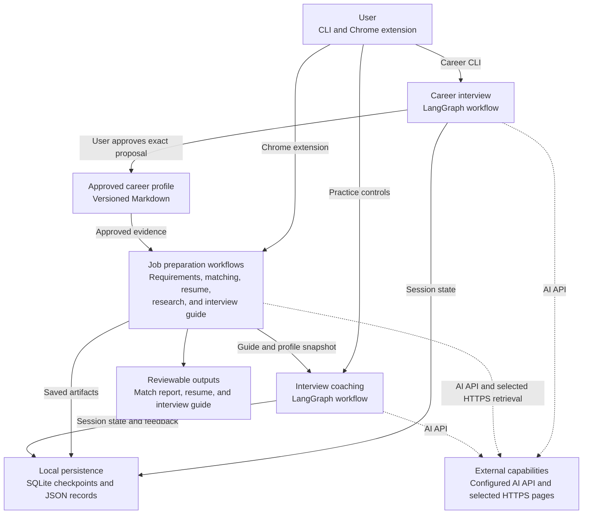
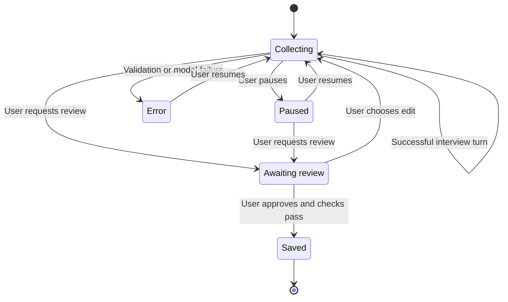
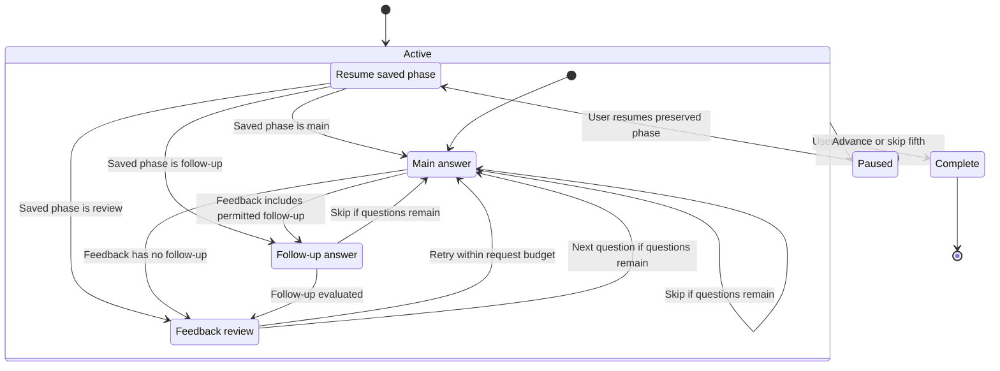

# Job Application and Interview Assistant

## Overview

This project implements a local, semi-autonomous workflow to help a candidate document career evidence, assess a saved job description, prepare application materials, and practice interviews. The goal is useful preparation without turning incomplete or invented claims into approved facts. The application combines a Chrome extension, a Python FastAPI backend, structured model calls, and two checkpointed LangGraph workflows. This is a project-specific implementation for job preparation; it does not submit applications or independently search for jobs.

The design is a single local application with focused model-assisted stages, rather than a coordinating multi-agent system. Models interpret user statements, classify qualification evidence, select resume records, draft preparation questions, and evaluate practice answers. Python controls transitions, validates references, calculates credit, and persists outputs. The user initiates consequential operations and approves profile changes and exact resume drafts. Research retrieves user-selected company pages; the model does not autonomously browse for sources.

The principal demonstrated result is separation of interpretation from authority. Reviewed snapshots show a current match, an approved resume, a five-question guide, and coaching tied to that guide. Earlier snapshots show stale outputs being rejected. These observations support the workflow controls, but they do not establish hiring effectiveness, ranking validity, or general model accuracy.

## System Architecture and Design

The application comprises six distinct workflows that share saved artifacts (Table 1). Each workflow is initiated by the user, and its outputs can become inputs to subsequent workflows. Career interviewing and interview coaching use checkpointed LangGraph state graphs. Requirements extraction, profile matching, resume preparation, and company research and interview-guide generation are application-controlled, model-assisted workflows. Within these workflows, models interpret requirements, assess or select evidence, and generate preparation material. Python controls execution, invokes external capabilities, validates outputs, and enforces approval requirements.

| Workflow                                        | Main inputs                                                                                   | Main output                                             | User review or approval                                 |
| ----------------------------------------------- | --------------------------------------------------------------------------------------------- | ------------------------------------------------------- | ------------------------------------------------------- |
| Career interview                                | Candidate’s career statements and any existing approved profile                               | Proposed changes and an approved career profile         | Review and approve proposed profile changes             |
| Job requirements extraction and review          | Captured job description                                                                      | Reviewed qualifications and practical constraints       | Review and correct extracted requirements               |
| Profile matching                                | Reviewed requirements and approved career profile                                             | Documented alignment and practical compatibility report | Inspect assessments, citations, and score contributions |
| Resume preparation                              | Job requirements and approved career profile                                                  | Resume draft and document exports                       | Approve the exact draft before export                   |
| Company research and interview-guide generation | Selected company sources, job requirements, approved profile, and optional recruiter guidance | Sourced interview guide                                 | Confirm and review sources; inspect the generated guide |
| Interview practice and coaching                 | Current interview guide and candidate’s practice answers                                      | Saved answers, feedback, and optional follow-ups        | Review questions and feedback                           |

*Table 1. Application workflows, inputs, outputs, and user controls.*

### Career Interview

The career interview gathers employment history, education, preferences, skills, projects, and accomplishments. The model acts as a factual career interviewer, asking one question at a time and distinguishing individual contributions from team outcomes. Accomplishment stories follow Situation, Task, Action, Result, and Reflection.

The workflow maintains a draft profile and conversation state across interactions. Proposed changes remain separate from approved career evidence. The candidate reviews a diff and approves the exact proposal before it replaces the saved profile. Version history preserves earlier approved information.

### Job Requirements Extraction and Review

This workflow converts a captured job description into structured qualifications and practical constraints. The model identifies each requirement’s importance and provides supporting excerpts from the original description. Qualifications describe capabilities or credentials; practical constraints describe conditions such as location or interview attendance.

Python checks that the cited excerpts occur in the captured text. The candidate can review and correct the extracted requirements without another model call. Revision checks prevent an older review from overwriting newer changes.

### Profile Matching

The matching workflow compares reviewed job requirements with the approved career profile. The model classifies each qualification as a strong match, transferable experience, missing evidence, or a confirmed gap. Assessments include explanations and supporting profile references where required. Missing documentation remains distinct from a confirmed lack of qualification.

Python validates evidence references and calculates the documented alignment percentage using fixed weights and credits. Practical compatibility is assessed separately and excluded from the percentage. Saved reports retain their input versions so changes to the profile, requirements, or scoring rules can trigger reassessment.

### Resume Preparation

The resume workflow selects relevant employment, accomplishment, and education records from the approved profile. The model selects existing record identifiers, and a deterministic Python renderer produces the draft text from those records.

The candidate reviews the draft and its supporting evidence before approving the exact version. Approval is tied to the reviewed text and evidence. Before exporting DOCX or PDF documents, the application checks that the approval remains valid and that the underlying sources have not changed.

### Company Research and Interview-Guide Generation

This workflow begins with the candidate supplying selected official company URLs. The application retrieves the pages and records their source information. The candidate confirms that the URLs are official and reviews the captured material before guide generation.

The model combines the reviewed sources, job requirements, approved career evidence, and any recruiter guidance to generate a job-specific interview guide. Recruiter guidance takes precedence over general hiring information. The guide distinguishes documented company information from generated practice questions and requests clarification where career evidence is insufficient. Python validates source citations and profile references.

### Interview Practice and Coaching

The practice workflow uses the generated guide to conduct a five-question session. The model acts as an interview coach, evaluating relevance, structure, specificity, ownership, results, and clarity. It provides feedback and may ask one follow-up per main question.

Checkpointed state preserves the current question, interaction phase, answers, feedback, and request budget. The candidate can retry, skip, pause, and resume within the application’s limits. Each session remains tied to its original guide and profile snapshot. Practice answers cannot automatically update the approved career profile; new career facts require separate review and approval.

Figure 1 shows the implemented component relationships. Career intake and coaching are the LangGraph workflows. Requirement extraction, matching, resume selection, research, and guide generation are ordinary Python services with structured model responses. The application has no supervisor, agent-to-agent negotiation, autonomous research planner, or repeated evaluator-optimizer rewrite loop. Keeping these boundaries explicit makes it possible to inspect which step interpreted language and which step authorized a write.

*Figure 1. Application components and their relationships. Solid arrows show data and control relationships; dashed arrows show external calls. Only the job preparation workflows retrieve selected HTTPS pages. Career-profile changes require explicit approval, and resume export requires approval of the exact draft.*

### Workflow State and Persistence

Career interviewing and interview coaching retain state between interactions so sessions can continue without losing progress. Their application states, transitions, and stored information are described below. The diagrams include user commands handled outside LangGraph; they do not imply that the model controls approval, pausing, or question advancement.

#### Career Interview State

A career interview starts in the **collecting** state, using either an existing approved profile or an empty draft. Each interview turn validates the draft before invoking the model. Successful turns update the draft and conversation history while the session remains collecting.

The candidate can pause the interview or prepare a proposal for review. Preparing a review captures the proposed Markdown, its differences from the approved profile, and the base revision. Approval saves the exact proposal only after the application verifies the proposal identifier, unchanged draft, and base revision. Editing cancels the pending proposal and returns the session to collecting.

_Figure 2. Principal career-interview state transitions. Review and approval are user-controlled operations outside the model’s authority._

A failed approval check leaves the proposal unsaved. Resuming after an interview error returns the session to collecting, but the next turn must still pass validation. After saving, the candidate can exit or explicitly restart an interview using the approved profile.

#### Interview Coaching State

Coaching tracks **session status** separately from **question phase**. Session status is active, paused, or complete. Within an active session, the question phase is main answer, follow-up answer, or feedback review.

A session begins with the first of five main questions. Evaluating a main answer either produces an optional follow-up or moves directly to feedback review. Evaluating the follow-up moves to review. From review, the candidate can retry the main question if the request budget permits or advance to the next question. Skipping is available from any active question phase. Advancing or skipping the fifth question completes the session.

_Figure 3. Coaching session status and question phases. “Next question” is permitted only after feedback review; skipping is permitted from any active question phase._

Pausing preserves the current question and phase. Each question permits at most one follow-up and four evaluation requests, including failed requests. Retrying does not reset the request count or restore an already-used follow-up. A failed evaluation preserves the answer and current phase, allowing another attempt when budget remains or a skip.

#### Persisted State Data

The diagrams show how sessions progress. Table 2 summarizes the information retained to support those transitions.

| State information          | Career interview                                                        | Interview coaching                                                        |
| -------------------------- | ----------------------------------------------------------------------- | ------------------------------------------------------------------------- |
| Conversation and responses | Conversation messages                                                   | Main answer, pending response, and follow-up question                     |
| Career evidence            | Current approved Markdown and editable draft profile                    | Approved-profile snapshot used for the session                            |
| Current focus              | Active story identifier                                                 | Five questions and current question index                                 |
| Progress                   | Session status and turn count                                           | Session status, question phase, and follow-up usage                       |
| Review and history         | Pending proposal identifier, proposed Markdown, diff, and base revision | Evaluated answers, feedback, and advance/skip events                      |
| Request control            | CLI interview-turn limit                                                | Evaluation request count for the current question                         |
| Source identity            | Approved-profile content used as the editing baseline                   | Guide content hash; saved-session metadata links the session to its guide |
| Error information          | Last interview error                                                    | Last coaching error                                                       |

_Table 2. Principal state information retained by the two conversational workflows._

SQLite-backed LangGraph checkpoints preserve conversational progress between interactions. LangGraph describes checkpoints as thread-scoped state that supports continuing interactions (LangChain, n.d.). The approved career profile is stored separately as versioned Markdown, while job requirements, match reports, resume artifacts, research, and guides use their own local records.

This separation distinguishes **saved conversation state** from **approved career evidence**. An interview draft requires explicit approval before replacing the profile. Coaching answers and feedback remain practice records and cannot automatically become approved facts.

The external capabilities are the configured AI API and bounded retrieval of selected HTTPS pages. The application also invokes local functions for schema validation, scoring, proposal storage, and DOCX/PDF rendering. The entry script delegates to these package modules; configuration and pinned dependencies are documented in the README. The tradeoff is a broader interface split: career intake uses a CLI, while the other main operations are available in Saved Jobs.

## Decision Logic and Behavior

Each intake turn proposes newly stated facts or explicit corrections. Null fields preserve existing information. Stable identifiers link stories to roles and distinguish completed education from ongoing study. An expected graduation date cannot be saved as an actual completion date. Invalid structured output leaves the draft unchanged. The user reviews a diff and approves its exact proposal UUID before downstream services can use the new facts.

Requirement extraction separates qualifications from practical conditions and marks importance as required, preferred, or unspecified. Exact contiguous JD excerpts are checked against the preserved capture. The review editor allows corrections without another model call, rejects clear duplicate descriptions, and uses a revision comparison to prevent stale-tab overwrites. Citation validation establishes provenance; it does not prove that edited wording or an explanation follows logically from the excerpt.

Matching returns strong match, transferable experience, evidence missing, or confirmed gap for each qualification. Positive classifications and confirmed gaps require profile evidence. Missing duration or undocumented capability must remain missing evidence rather than a confirmed gap. Practical compatibility is evaluated separately: compatibility or a blocker requires supporting profile evidence, while ambiguity remains a clarification request.

Python calculates the documented alignment percentage. Required qualifications have weight 2 and preferred qualifications weight 1. Strong match earns full credit, transferable experience half, and missing evidence or a confirmed gap zero. Unspecified importance and practical constraints are excluded. With no scoreable qualifications, the result is unavailable. Each contribution is displayed, and the final percentage is rounded once to one decimal place. The current rule label is documented-alignment-v1; saved matches are keyed to profile, requirements, and scoring-rule versions.

Resume generation selects existing role, story, and education identifiers. A deterministic renderer produces text from those approved records. Approval binds the reviewed text and evidence files, and export revalidates their sources and approval before producing documents. Guides combine validated source citations with qualification-linked questions and candidate evidence. Coaching can ask one follow-up per main question and evaluates that response with the original answer. It cannot amend the approved profile.

## Safety Reliability and Transparency

The central safeguard is an authority boundary: models propose interpretations, while the user authorizes profile and resume approval. Supporting excerpts, explanations, editable requirements, and explicit controls make errors inspectable. These choices are consistent with the human-AI interaction emphasis on correction and understandable behavior described by Amershi et al. (2019). They do not make model interpretations infallible.

Reliability checks reject unknown record IDs, invented excerpts, duplicate assessment coverage, mismatched source hashes, and outdated rule versions. Atomic writes and local locks protect selected updates. Request identities reuse completed operations; an unfinished reservation is not silently repeated. Research is limited to one to five selected HTTPS URLs, with public-address checks, no redirects, and response/time limits. These measures reduce specific risks; they are not a comprehensive security certification.

Practice is bounded to five questions, at most one follow-up per question, and four evaluation requests per question including failures. The browser API reserves budget before a provider request so interruptions cannot silently restore it. A failed evaluation preserves the answer. Existing sessions stay pinned to their original guide and can be labelled outdated, while new practice needs a current guide. DOCX/PDF export checks extracted text order, but visual layout still needs human inspection.

The score is explicitly documented alignment, not a probability or employer ATS score. Model calls are user-initiated and may incur charges. Saved-result reads do not trigger new assessments. The evidence collector uses only authenticated GET requests and records actual absent/outdated outcomes. Its hashes detect content differences against the supplied bundle; they do not authenticate the original execution or establish semantic correctness.

## Observed Behavior and Limitations

The reviewed evidence contains three saved API snapshots collected on November 20, 2026. They are observations of previously executed application outputs, not three independent model experiments. Provider request times and model identity are not inferred where absent. Table 3 summarizes the transition from stale artifacts to a current workflow. The public evidence file omits personal practice answers and selected fields; those redactions are explicit.

| Snapshot       | Observed saved state                                                 | Interpretation                                                   |
| -------------- | -------------------------------------------------------------------- | ---------------------------------------------------------------- |
| A at 20:29 UTC | Resume, research, and guide returned HTTP 409; practice was outdated | Changed inputs prevented reuse of dependent outputs              |
| B at 20:45 UTC | Resume approved and research readable; guide still returned 409      | Partial refresh did not falsely make the guide current           |
| C at 21:51 UTC | All eight reads returned 200; practice used the current guide        | A successful saved-workflow snapshot after explicit regeneration |

*Table 3. Collection times identify evidence snapshots, not original provider execution times.*

In snapshot C, 13 extracted conditions comprised 11 scored qualifications and two excluded practical constraints. A completed fictional bachelor's degree and a documented leadership story were strong matches. The other nine qualifications lacked sufficient evidence. The earned credit was 2 plus 2, with 17 available credits, giving 23.5%. Independent recomputation matched every contribution and the total. All 24 response-body hashes across the three snapshots matched, and the JD hash and all 13 source excerpts checked successfully.

The fictional master's degree remained in progress and was not counted as an awarded qualification. The candidate's remote-only preference did not establish that a listed city required onsite work or that the candidate would refuse an in-person interview. Both practical conditions remained unresolved. A separate user-reported fictional onsite-only test produced a blocker, but that separate test is not represented by these three raw snapshots and is not used as a quantitative evaluation result.

The latest guide contained five distinct qualification-linked questions. Two answer drafts used approved degree and leadership evidence; three requested clarification instead of inventing software-development experience. The captured company page supported general product context, but no documented hiring-stage information was established. Research coverage was therefore visibly limited rather than expanded into unsupported company-specific interview claims.

The new practice session referenced the current guide and had context_outdated set to false. Its history contained a main response and one follow-up with all six feedback dimensions. The coach flagged education details that differed from the approved fictional profile and suggested separate review and approval. The approved snapshot still contained the fictional degree facts. That is useful evidence of the authority boundary; subjective coaching ratings are not independent measurements of answer quality.

A real recovery limitation occurred during guide refresh: an earlier incomplete request reservation caused repeated HTTP 409 responses for the same request ID. After checking the earlier operation and reopening Saved Jobs, the user explicitly generated a new guide successfully. This avoided deleting saved files, but recovery was cumbersome and the original failed operation's cause was not established. A clearer operation-status and recovery interface remains necessary.

Fresh Linux/Python 3.12 installation passed dependency validation, 314 Python tests, and 34 simulated-browser tests. Those checks use injected provider responses and support deterministic behavior, not live model quality. The saved live evidence does not verify every export layout, all five practice questions, or ranking usefulness across jobs. Exact-excerpt checks also cannot eliminate unsupported semantic conclusions.

## Ethical and Responsible Use Considerations

The main ethical risk is misrepresenting a candidate through fabricated or overconfident claims. This system reduces that risk through approved evidence, exact references, and separate handling of new practice claims. The observed education conflict illustrates why useful conversational content must not silently replace career facts. The user remains responsible for confirming truthfulness before using an application document.

Another risk is treating incomplete documentation as a measure of a person's ability. A low percentage may reflect missing evidence, and the initial weights have not been validated against hiring decisions or diverse candidate histories. Ranking could consequently hide relevant opportunities or disadvantage less completely documented careers. The application retains clarification states and avoids hiring-probability language, but these controls do not establish fairness. NIST's risk framework stresses evaluating risks within the system's use context (Tabassi, 2023); for this project, that means testing interpretation and ranking across varied profiles before increasing reliance.

Local storage does not mean that data never leaves the computer. Explicit AI actions send career evidence and answers to the configured provider, and checkpoints and saved bundles can contain personal details. The final practice answers included personal education information, so the repository evidence uses selected and redacted summaries.

## Future Improvements

The first priority is clearer recovery for incomplete requests, including visible operation state and an explicit, bounded way to start a new attempt. Further evaluation should use a small, human-reviewed set of varied profiles and jobs to measure citation entailment, threshold interpretation, and the usefulness of ranking. It should include paraphrased duplicate requirements and cases where missing evidence changes ordering. No such evaluation is claimed here.

Open product gaps include cross-UUID duplicate-capture warnings, persistent intake topic skipping, employer file-format guidance, and previous-resume comparisons. Standalone skill/project facts support matching and guides, but not resume sections.

## References

Amershi, S., Weld, D., Vorvoreanu, M., Fourney, A., Nushi, B., Collisson, P., Suh, J., Iqbal, S., Bennett, P. N., Inkpen, K., Teevan, J., Kikin-Gil, R., & Horvitz, E. (2019). Guidelines for human-AI interaction. In Proceedings of the 2019 CHI Conference on Human Factors in Computing Systems (pp. 1-13). Association for Computing Machinery. https://doi.org/10.1145/3290605.3300233

LangChain. (n.d.). Persistence. Docs by LangChain. Retrieved November 20, 2026, from https://docs.langchain.com/oss/python/langgraph/persistence

Tabassi, E. (2023). Artificial intelligence risk management framework (AI RMF 1.0) (NIST AI 100-1). National Institute of Standards and Technology. https://doi.org/10.6028/NIST.AI.100-1
